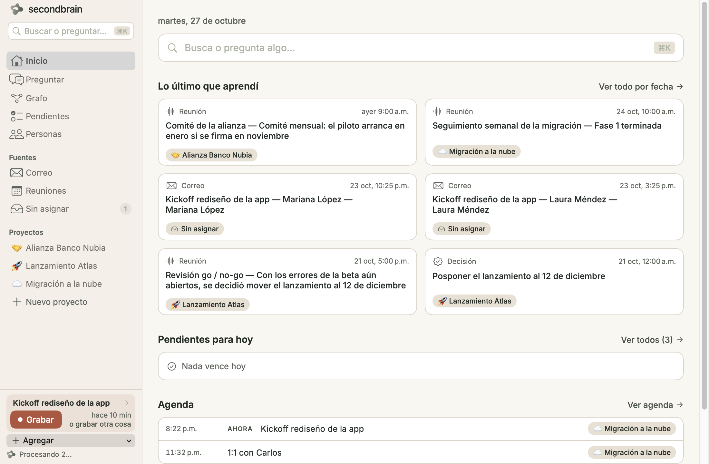
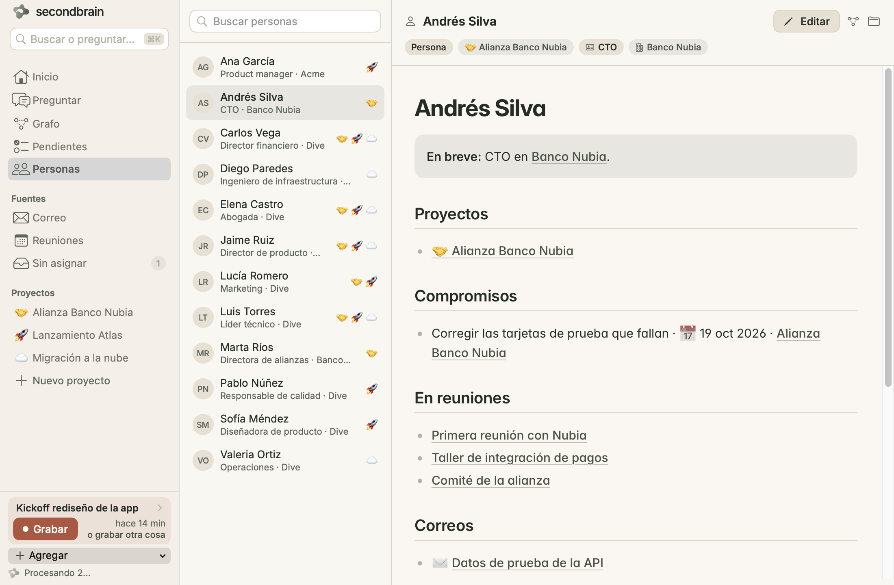
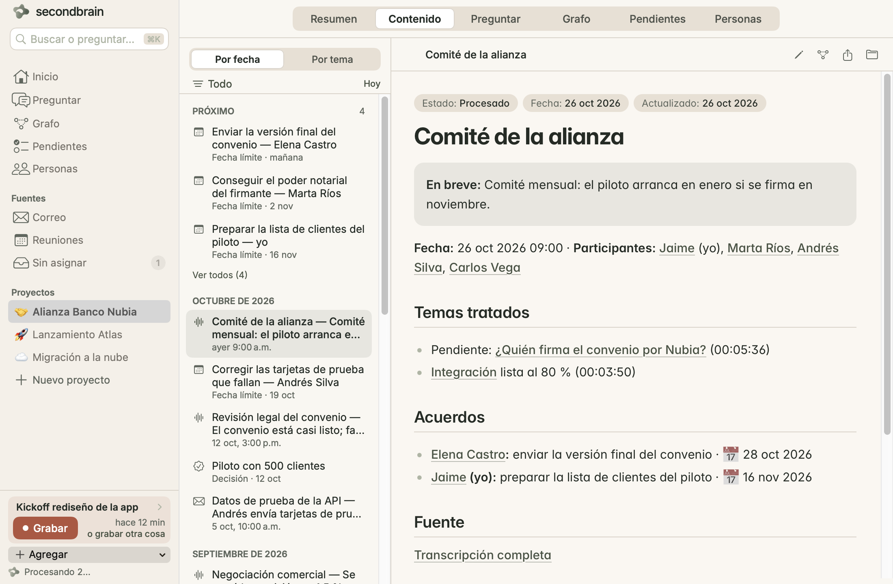
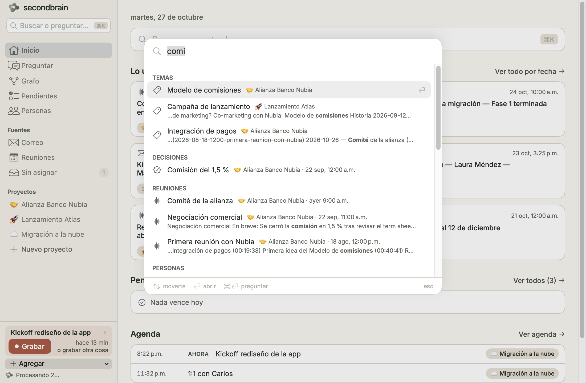
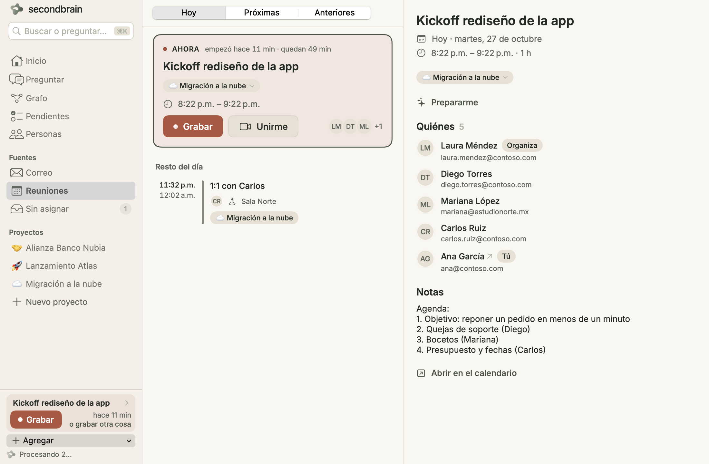

# secondbrain

Tu segundo cerebro por proyecto, 100% en tu Mac. Junta lo que pasa en tu día —correos, notas, documentos, enlaces, repos de GitHub y reuniones (graba el audio de la computadora + tu micrófono y lo transcribe localmente)— y Claude —con **tu propia cuenta**, sin API key— mantiene un wiki ordenado de cada proyecto: resúmenes, decisiones, pendientes, personas y temas. Basado en la idea *LLM Wiki* de Andrej Karpathy.



## Novedades 0.6.0

El lugar fija el ámbito, todo tiene una ficha y capturar es tan fácil como grabar.

- **El lugar fija el ámbito.** Dentro de un proyecto, Preguntar, Grafo y Pendientes son solo del proyecto; fuera, son de todo tu cerebro. Ya no hay interruptor "Este proyecto | Todo el cerebro". La barra lateral es **Inicio · Preguntar · Grafo · Pendientes · Personas**, **Correo · Reuniones · Sin asignar** y tus proyectos.
- **Proyectos con seis pestañas:** Resumen · Contenido · Preguntar · Grafo · Pendientes · Personas (agrega o quita personas a mano).
- **Fichas.** Cualquier persona, empresa, tema, decisión o reunión tiene una ficha con lo que sabemos, sus reuniones, correos, decisiones, pendientes y relacionados. **⌘K** busca en el texto completo.
- **Preguntar guarda tus conversaciones**, abre las citas al lado y puede **Guardar como página**.
- **Corregir el cerebro:** edita una página y revisa los cambios propuestos en las demás; queda como hecho confirmado.
- **Captura rápida** con **⌥⌘N** desde cualquier app, y **+ Agregar** en la barra lateral.
- **Empresas** (`orgs/`) como fichas globales, y el Grafo muestra la ficha en un panel al lado.
- Las conversaciones guardadas son por cerebro; **⌥⌘N** reemplaza "Nueva carpeta inteligente" del Finder mientras secondbrain está abierta.

## Instalar

**Necesitas:** una Mac con Apple Silicon (M1 o más nueva) con macOS 15 Sequoia o posterior, unos 5 GB libres, conexión a internet la primera vez y una suscripción de Claude **Pro o Max**. No necesitas saber programar ni tener una API key.

1. Descarga `SecondBrain-<versión>.dmg` de la página de **Releases** (sección *Assets*).
2. Ábrelo y arrastra **SecondBrain** a la carpeta **Aplicaciones** (el atajo está en la misma ventana). En el Dock y en la barra de menús se llama **secondbrain**.
3. Abre SecondBrain desde Aplicaciones. La primera vez macOS dirá que *no puede verificar* la app (no está notarizada por Apple). Pulsa **Listo**, ve a **Ajustes del Sistema → Privacidad y seguridad**, baja hasta el aviso de SecondBrain y pulsa **Abrir de todos modos** (te pedirá tu contraseña). Solo se hace una vez.
4. Sigue la bienvenida:
   - **Conectar Claude:** si no tienes Claude Code, secondbrain lo instala; luego se abre el navegador para que inicies sesión con tu cuenta.
   - **Permisos y modelo:** se piden la primera vez que pulsas **Grabar**: *Audio de la computadora* (macOS lo llama "Grabación de pantalla y audio del sistema"; no se graba tu pantalla), *Micrófono* y la descarga del modelo de transcripción (~3 GB, una sola vez; de 2 a 10 minutos según tu internet).

## Si algo no funciona

- **"No se puede abrir porque Apple no puede verificar…"** → Ajustes del Sistema → Privacidad y seguridad → **Abrir de todos modos** (paso 3). Clic derecho → Abrir ya no basta en macOS 15.
- **No graba a los demás / la transcripción solo tiene tu voz** → Ajustes del Sistema → Privacidad y seguridad → **Grabación de pantalla y audio del sistema**: activa SecondBrain. Después **cierra y vuelve a abrir** SecondBrain (macOS lo exige).
- **No graba tu voz** → Privacidad y seguridad → **Micrófono**: activa SecondBrain.
- **Claude no responde / "reconecta tu cuenta"** → abre los **Ajustes** (con la ventana de secondbrain al frente: menú *secondbrain → Ajustes…*, o ⌘,) → pestaña *Cuentas* → *Cuenta de Claude* → **Reconectar Claude** e inicia sesión de nuevo. Revisa que tu suscripción Pro/Max siga activa.
- **La descarga de modelos falló o se cortó** → pulsa **Reintentar** (o Ajustes → Avanzado → Transcripción → *Descargar ahora*). Continúa donde se quedó; no hace falta borrar nada.
- **La primera transcripción tarda en empezar** → la primera vez macOS prepara los modelos para tu chip (1–2 min). Después es inmediato.
- **Ya diste el permiso pero no graba** (sobre todo al actualizar desde 0.5.2 o anterior: el interruptor sigue activado, pero macOS lo dejó ligado a la versión anterior y ya no lo aplica ni vuelve a preguntar) → en el aviso bajo **Grabar** pulsa **Reparar permiso**, acepta lo que pida macOS y vuelve a abrir secondbrain. A mano: en *Grabación de pantalla y audio del sistema* (y *Micrófono*) quita secondbrain con **−** y vuelve a abrirlo. Desde 0.5.3 los permisos se conservan al actualizar.

## Dónde están tus archivos

| Qué | Dónde |
|---|---|
| Tu wiki, transcripciones y notas (markdown, se abre con Obsidian) | `~/Documents/SecondBrain` (o la carpeta que elegiste; Ajustes → Avanzado → *Dónde se guarda* → *Mostrar en Finder*) |
| Ajustes de la app | `~/Library/Application Support/SecondBrain/config.json` |
| Audio pendiente de transcribir, historial de cambios y modelos (~3 GB) | `~/Library/Application Support/SecondBrain/data` |
| Conexión con Claude y con tus cuentas de correo/calendario | Llavero de macOS, elementos `app.secondbrain.mac` |
| Cuentas conectadas y proyecto de cada reunión | `~/Library/Application Support/SecondBrain/data/accounts.json`, `meetings.json` |

`~/Library` está oculta: en Finder usa **Ir → Ir a la carpeta…** (⇧⌘G) y pega la ruta.

## Desinstalar

1. Cierra secondbrain (símbolo de secondbrain en la barra de menús → Salir) y arrastra **SecondBrain** de Aplicaciones a la Papelera.
2. Borra la carpeta `~/Library/Application Support/SecondBrain` (ajustes, audio pendiente, historial y los ~3 GB de modelos).
3. *Opcional:* borra tu wiki (`~/Documents/SecondBrain` o la carpeta que elegiste) — **ahí está todo lo que aprendió; haz una copia si lo quieres conservar.**
4. *Opcional:* en **Acceso a Llaveros** busca `app.secondbrain.mac` y bórralo; en Privacidad y seguridad quita SecondBrain de *Micrófono* y *Grabación de pantalla y audio del sistema*. Claude Code (`~/.local/bin/claude`) es independiente; bórralo solo si no lo usas para nada más.

## Usar

El lugar fija el ámbito: fuera de un proyecto todo es de tu cerebro completo; dentro de un proyecto, todo es de ese proyecto. La barra lateral va **Inicio · Preguntar · Grafo · Pendientes · Personas** (**⌘1–⌘5**), luego **Correo · Reuniones** (**⌘6**, **⌘7**), **Sin asignar** (solo si hay algo, con contador) y tus proyectos. **⌘K** busca en todo.

- **Inicio (⌘1):** **Lo último que aprendí** (las últimas fuentes procesadas, de cualquier tipo), **Pendientes para hoy**, tu **Agenda** (si conectaste un calendario) y una línea "n por ordenar" si hay algo sin proyecto. **Historial** (arriba a la derecha) muestra qué cambió Claude y permite **deshacer**. Arrastra un archivo a Inicio y queda en *Sin asignar*.
- **Preguntar (⌘2):** conversaciones guardadas a la izquierda, la conversación a la derecha. Las citas se abren en un panel al lado; **Guardar como página** deja la respuesta en tu cerebro.
- **Grafo (⌘3), Pendientes (⌘4) y Personas (⌘5):** ver abajo y en cada proyecto.
- **Buscar o preguntar (⌘K):** busca en el texto completo, sin preocuparte por acentos ni mayúsculas. Grupos: Personas · Empresas · Temas · Decisiones · Reuniones · Correos · Notas y documentos · Preguntas guardadas · Repos · Pendientes · Proyectos · Acciones. ↑↓ para moverte, ↩ para abrir, esc para cerrar; la última fila es **Preguntar a todo el cerebro: «…»** (⌘↩).
- **Correo y Reuniones:** **Guardar en 🚀 Proyecto ▾** agrega un correo al proyecto; Reuniones es **Hoy · Próximas · Anteriores** (ver abajo).
- **Pendientes:** **Míos · De otros · Sin dueño · Hechos**, **Origen ▾** y **Exportar**; fuera de un proyecto, además, filtros por proyecto y persona. Cada pendiente muestra de qué reunión o correo salió.
- **Proyecto:** seis pestañas.
  - **Resumen:** en breve, decisiones recientes, próximas fechas, personas, actividad y tus pendientes abiertos.
  - **Contenido:** lista **Por fecha** (lo más nuevo primero, agrupado por mes) o **Por tema**; a la derecha la página.
  - **Preguntar · Grafo · Pendientes:** las mismas vistas, solo de ese proyecto.
  - **Personas:** quién aparece en el proyecto; **+ Agregar persona** o *Quitar del proyecto* (clic derecho).
  - En la barra de herramientas: **+ Agregar** (Nota · Archivo… · Enlace… · Pegar correo ⇧⌘V · Grabar aquí), **Historial** y **⋯** (formato por defecto, **Repositorios…**, Mostrar en Finder). También puedes arrastrar PDFs, textos o enlaces al proyecto. Clic derecho en un proyecto de la barra lateral → *Editar proyecto…*.
- **Fichas:** haz clic en cualquier nombre, enlace, cita o punto del grafo y se abre su ficha: la página que escribió Claude más lo que sabemos de esa persona, empresa, tema o decisión (reuniones, correos, documentos, decisiones, pendientes y relacionados). Dentro de un proyecto la ficha se filtra a ese proyecto ("En 🚀 Kickoff · Ver todo →"). **⌘[** vuelve atrás.

  

- **Corregir el cerebro:** **Editar** en cualquier página o ficha (⌘S guarda, esc cancela). Al guardar, Claude propone cambios en las demás páginas que decían lo mismo; los revisas en **Revisar cambios en el cerebro**, aplicas los que quieras y todo es deshacible desde el Historial. Lo corregido queda en **Hechos confirmados** (`facts.md`): Claude lo lee antes de cada tarea y no lo contradice; si una fuente nueva lo contradice, lo avisa en lugar de sobrescribirlo.
- **Captura rápida:** **⌥⌘N** desde cualquier app abre un cuadro flotante: escribe o pega una nota, un enlace o un correo, o suelta un archivo; elige proyecto (o deja el sugerido), **⌘↩** guarda y esc cierra. Se puede cambiar o desactivar en Ajustes → General. La barra de menús abre primero el mismo cuadro, con Grabar debajo. **+ Agregar** (barra lateral) hace lo mismo con el mouse. Los correos que caen en una regla se guardan solos.
- **Grabar:** una reunión en curso del calendario o una grabación activa toman el pie de la barra lateral ("Grabar «Kickoff…»", "Detener 12:04"); si no, **Grabar** está en **+ Agregar** y en la barra de menús. Al detener se transcribe y Claude aprende de la reunión solo. Desde cualquier app: **⌥⌘R** (Ajustes → General). La primera vez macOS pide los permisos de micrófono y grabación y se descarga el modelo de transcripción.
- **Sin asignar:** si no eliges proyecto, lo que entra aparece en *Sin asignar* con una sugerencia de proyecto.





## Ver tu cerebro (Grafo)

**Grafo** en la barra lateral dibuja todo tu cerebro como un mapa (cada página es un punto, cada enlace una línea; los colores son tus proyectos); la pestaña **Grafo** de un proyecto dibuja solo ese proyecto (colores por tipo: reuniones, correos, personas, decisiones…). Haz clic en un punto para resaltarlo y ver su ficha en un panel al lado; doble clic (o **Abrir**) va a la ficha completa. Pulsa reproducir para ver cómo creció tu cerebro con el tiempo.

## Reuniones

La sección **Reuniones** (⌘7) tiene tres vistas: **Hoy** (con la reunión de ahora o la siguiente arriba), **Próximas** (desde mañana, por día) y **Anteriores** (todas las reuniones que grabaste, la más reciente primero, con su proyecto y *Ver resumen*; funciona aunque no conectes un calendario).

- **Antes:** *Prepararme* te enseña quiénes van, qué quedó pendiente con ellos y qué preguntar; con *Preparar con Claude* obtienes agenda y preguntas sugeridas.
- **Durante:** cuando la reunión empieza, el botón se vuelve **Grabar** (el mismo que en la barra lateral y en la barra de menús). Título, proyecto y asistentes ya van puestos.
- **Después:** *Ver resumen* abre la página que Claude escribió, también desde *Anteriores*.

Para ver tu agenda hay dos caminos: **Usar el calendario de la Mac** (un clic, macOS te pide permiso; sirve con cualquier cuenta que ya tengas en la app Calendario) o conectar tu cuenta de Microsoft 365 / Google (abajo). *Reglas…* está en el menú **⋯** de Reuniones.



## Conectar correo y calendario (Microsoft 365 / Google)

En **Ajustes → Cuentas** (o desde las secciones *Correo* y *Reuniones*) pulsa **Conectar Microsoft 365** o **Conectar Google**. Se abre tu navegador, inicias sesión y listo. secondbrain **solo lee**: nunca envía, borra ni mueve nada, y tu correo se queda en tu Mac. Puedes desconectar cuando quieras.

- **Correo:** en la sección *Correo* ves tus mensajes recientes y con un botón los guardas en el proyecto que elijas ("Guardar en 🚀 Proyecto ▾"). Si el mensaje es parte de un hilo, se guarda completo. Siempre puedes deshacer ("Aprendiendo del correo… · Deshacer"). Con más de una cuenta conectada, el selector de cuenta está arriba de la lista.
- **Tu organización bloquea la conexión** ("necesita aprobación del administrador", "access blocked"): pulsa **¿Problemas para conectar tu cuenta del trabajo?** (Ajustes → Cuentas) o **¿Cómo lo habilito?** en el aviso de bloqueo. Ahí tienes un mensaje listo para enviarle a TI (botón *Pedírselo a TI*) y los pasos exactos para el administrador:
  - *Microsoft 365:* en el centro de administración de Microsoft Entra, abrir `https://login.microsoftonline.com/common/adminconsent?client_id=<ID de la app>` y **Aceptar**, o en *Aplicaciones empresariales → Consentimiento y permisos* permitir que los usuarios den consentimiento a permisos de bajo impacto. Permisos pedidos: `User.Read`, `Mail.Read`, `Calendars.Read`, `offline_access` (todos delegados, solo lectura).
  - *Google Workspace:* en la consola de administración, *Seguridad → Control de acceso y datos → Controles de API → Gestionar acceso de aplicaciones de terceros → Añadir aplicación* → buscar por ID de cliente → marcar **De confianza**. Permisos pedidos: `gmail.readonly`, `calendar.readonly`, `openid email profile`.
  - Mientras tanto, puedes seguir pegando correos (*Edición → Pegar correo…*, ⇧⌘V) y usar el calendario de la Mac.
- **Registro de la aplicación (solo para quien distribuye SecondBrain):** la conexión usa OAuth con un *ID de cliente* por proveedor. Se crea una vez y **no va en el código**: `scripts/build-app.sh` lo inyecta en el `.app` desde `secrets/` en el repo (ignorada por git; si no existe, `~/.config/secondbrain/`) (`google-client.json` = el archivo `client_secret_….json` que descarga Google Cloud, tal cual; `microsoft-client-id.txt` = el *Id. de aplicación (cliente)* de Entra, una línea). Para probar sin compilar: *Ajustes → Avanzado → Registro propio de apps* o variables `SB_MS_CLIENT_ID`, `SB_GOOGLE_CLIENT_ID`, `SB_GOOGLE_CLIENT_SECRET`:
  - *Microsoft:* Entra → *Registros de aplicaciones → Nuevo registro* → cuentas en cualquier directorio y personales → plataforma *Aplicaciones móviles y de escritorio* con URI `http://localhost` → *Autenticación → Permitir flujos de cliente público: Sí* → *Permisos de API*: `User.Read`, `Mail.Read`, `Calendars.Read`, `offline_access` → copia el *Id. de aplicación (cliente)*.
  - *Google:* Google Cloud → *Pantalla de consentimiento OAuth* (interna si es Workspace; externa + usuarios de prueba si no) con los permisos de Gmail y Calendar de solo lectura → *Credenciales → Crear ID de cliente OAuth → Aplicación de escritorio* → copia el ID y el secreto de cliente.

## Conectar tus repositorios de GitHub

En **Ajustes → GitHub** pulsa **Conectar GitHub** (código de dispositivo en tu navegador, **Usar mi sesión de GitHub CLI** o pegar un token). Después, en cada proyecto abre **⋯ → Repositorios…** (en la barra de herramientas del proyecto) y agrega los repositorios que quieras: **varios por proyecto**, y de cada uno **solo las ramas que elijas** (por ejemplo `main` y `development`). Lo demás del repo se ignora.

- **Actualización automática:** secondbrain revisa tus ramas cada cierto tiempo (por defecto cada 60 minutos; lo cambias en Ajustes). Es incremental: si nada cambió, no hace nada. Si alguien reescribe una rama (force-push, rebase) o la borra, lo detecta y lo anota.
- **Qué aprende:** commits de cada rama, pull requests, issues, releases, y las diferencias entre ramas (qué está en `development` y todavía no en `main`). El código de las ramas elegidas se guarda en tu Mac para poder responder preguntas sobre él.
- **Privacidad:** acceso de **solo lectura** (nunca hace push, comentarios ni cambios). El código se queda en tu Mac; a Claude solo llega el texto que necesita para responder, a través de tu cuenta.
- **Preguntas que cruzan código con correos y reuniones:**
  - "¿Lo que pidió Ana en el correo ya está en development?"
  - "Prepárame la llamada de alcance con lo que cambió esta semana."
  - "¿Qué PRs siguen abiertos y qué dijo el cliente sobre ellos?"
- **Terminal:** `sb github status`, `sb github login --gh|--device|--token -` (`--token -` reads the token from stdin, e.g. `pbpaste | sb github login --token -`), `sb github logout`, `sb github add`, `sb github remove`, `sb github sync [--project] [--repo] [--if-due]`.
- **Organizaciones que restringen apps:** si tu organización exige aprobación, pídele a un admin aprobar SecondBrain (Third-party access policy) o autoriza el token con SAML SSO.

## Reglas: cada correo y reunión a su proyecto

Si todo te llega a una sola cuenta, las **Reglas** (Ajustes → Reglas, o *Reglas…* en el menú **⋯** de Correo y de Reuniones) deciden a qué proyecto va cada cosa: "lo que venga de @acme.com va a 🚀 Acme", "si el asunto dice Nubia va a 🤝 Alianza", "las reuniones que organiza ana@acme.com…". Gana la primera que coincide; lo que no coincide con ninguna cae en *Sin asignar* (o en el proyecto por defecto que elijas) y lo asignas a mano. Cada vez que asignas algo a mano, secondbrain te propone la regla con un clic ("¿Mandar siempre lo de @acme.com a 🚀 Acme? · Sí, siempre · Solo esta vez"). Las reglas se reordenan arrastrándolas. Las reglas nuevas de correo **agregan automáticamente** los correos nuevos que coincidan (puedes apagarlo por regla), revisando tu correo cada 15 minutos.

## Apariencia

**Ajustes → General → Apariencia**: *Sistema*, *Claro* u *Oscuro* (también en el menú *Ver*). Cambia al instante, también en las páginas y el grafo. La app usa la identidad de **secondbrain**: nombre siempre en minúsculas, tipografía Inter, fondos marfil (claro) o verde tinta (oscuro), olivo para las acciones y un solo rojo, apagado, para grabar. La ventana mide como mínimo 920×620.

## Privacidad

El audio se transcribe en tu Mac y se borra después. Las transcripciones y el wiki son archivos markdown en tu carpeta (por defecto `~/Documents/SecondBrain`, compatible con Obsidian). Lo único que sale de tu Mac es el texto que Claude lee para escribir el wiki, a través de tu cuenta. Si grabas a otras personas, pide su consentimiento.

## Desarrollo

```bash
cd app && swift build                 # compila (solo Command Line Tools)
scripts/make-dev-cert.sh              # identidad de firma local (permisos estables entre builds)
scripts/build-app.sh [--release]      # build/SecondBrain.app (+ dist/*.zip y *.dmg con --release); ícono desde scripts/icon/secondbrain.iconset
scripts/release.sh <versión>          # publica en GitHub Releases
```

- **Arquitectura y contrato entre módulos:** `docs/CONTRACT.md`. Los módulos son `Recorder`, `Transcription` (WhisperKit + SpeakerKit), `BrainCore` (cola, Claude, historial, vault), `SecondBrain` (UI) y `sb` (CLI).
- **El esquema del cerebro** está en `app/Sources/BrainCore/Resources/vault-template/`.
- **Marca:** el kit está en `docs/brand/` y su uso en código en `docs/brand/USAGE.md`; todos los colores y fuentes salen de `app/Sources/SecondBrain/Support/Brand.swift` (y de las variables `:root` de `wiki.css`/`graph.css`). Reglas de UX y layout: `docs/CONTRACT.md` §15 (v0.5) y §16 (v0.6, vinculante).
- **Nombre:** el ejecutable y el paquete siguen siendo `SecondBrain` / `SecondBrain.app`; lo que ve el usuario (`CFBundleName`, `CFBundleDisplayName`, textos) es `secondbrain`.
- **Pruebas:** `sb selftest` (incluye ruteo y grafo), `sb github selftest`, `sb entity selftest` (índice y backlinks), `sb chat selftest` (conversaciones guardadas), `sb facts selftest` (ediciones propuestas y `facts.md`) y `sb search selftest` (texto completo). `sb chat list [--project]` lista conversaciones guardadas.
- **Capturas para revisar la UI:** `SB_SNAPSHOT_DIR=<carpeta>` renderiza cada vista a PNG y sale; con `SB_SNAPSHOT_WINDOW=1` renderiza la ventana completa (1100×720 y 920×620, claro y oscuro); `SB_SNAPSHOT_ONLY=<prefijo>` limita cuáles; `SB_DEMO_ACCOUNTS=1` y `SB_DEMO_GITHUB=1` usan datos de ejemplo.

---

**English:** secondbrain records your meetings locally (system audio + mic), transcribes them on-device, and uses your own Claude account (via Claude Code) to maintain a per-project markdown wiki.

- **Install:** requires an Apple Silicon Mac on macOS 15+, ~5 GB free and a Claude Pro/Max plan. Open the `.dmg`, drag SecondBrain to Applications and open it. When macOS says it can't verify the app (not notarized), go to *System Settings → Privacy & Security* and click **Open Anyway** (*Abrir de todos modos*). Then connect Claude (browser sign-in); the *System Audio Recording* and *Microphone* permissions and the transcription model download (~3 GB, once) happen the first time you click **Record**.
- **Troubleshooting:** no other voices in the transcript → enable SecondBrain under *Privacy & Security → Screen & System Audio Recording* and reopen the app; already enabled but it still can't record (after updating from 0.5.2 or earlier, the switch stays on but belongs to the old build) → **Fix permission** under *Record*, or remove secondbrain from the list with **−** and reopen it (from 0.5.3 on, permissions survive updates); Claude errors → *secondbrain → Settings… (⌘,) → Accounts → Claude account → Reconnect Claude*; a failed model download resumes with *Retry*.
- **Files:** wiki in `~/Documents/SecondBrain` (or the folder you chose); settings, pending audio, history and models in `~/Library/Application Support/SecondBrain`; the Claude token in the Keychain (`app.secondbrain.mac`).
- **What's new in 0.6.0:** place sets the scope (no more "This project | Whole brain" switch): the sidebar is *Home · Ask · Graph · Tasks · People*, then *Mail · Meetings · Unassigned* and your projects; a project has six tabs (*Summary · Content · Ask · Graph · Tasks · People*). Every person, company, topic or decision has an **entity page** (what we know, with its meetings, mail, decisions, tasks and related items); **⌘K** searches full text; *Ask* keeps saved conversations and can save an answer as a page. **Edit** any page and review the changes proposed on other pages: corrections become confirmed facts in `facts.md` that Claude won't contradict. **⌥⌘N** opens quick capture (note, link, email, file) from any app; recording permissions are asked the first time you record. Saved conversations are per brain; ⌥⌘N replaces Finder's "New Smart Folder" while secondbrain runs. Everything from 0.5.x is included.
- **0.5.0:** a lowercase **secondbrain** identity (new mark and icon, Inter, warm light and dark themes, one muted red for recording), simpler navigation, **⌘K** search and screens that fit a 920×620 window.
- **v0.3:** *Graph* tab (your brain as a map, colored by project or by type, with a time replay), *Meetings* (agenda from the Mac Calendar or a connected account; prepare with Claude, record with one click, open the summary), *Mail* (read recent messages from Microsoft 365 / Google and add them to a project; read-only), and Light/Dark/System appearance. If your organization blocks the sign-in, open **Trouble connecting a work account?** (Settings → Accounts) or **How do I enable it?** on the block notice for a ready-to-send message to IT and the exact admin steps (Microsoft: admin consent URL; Google: Admin console → Security → API controls → Manage Third-Party App Access → Trusted). Distributors must register an OAuth client per provider and put the ids in `OAuthDefaults` (or Settings → Advanced).
- **Uninstall:** quit, delete the app, delete `~/Library/Application Support/SecondBrain`, and optionally your wiki folder (back it up first) and the `app.secondbrain.mac` Keychain item.
